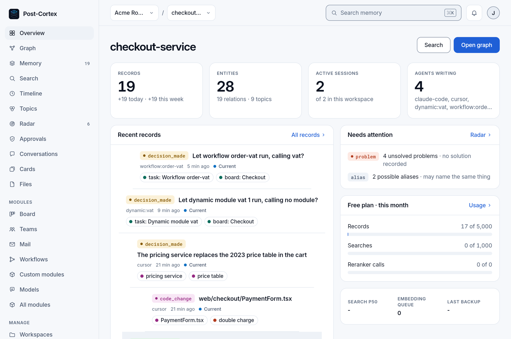
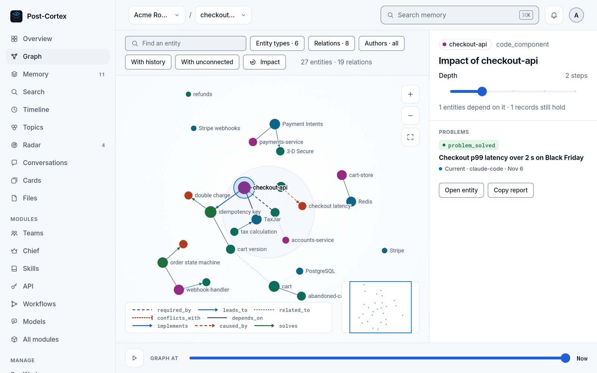
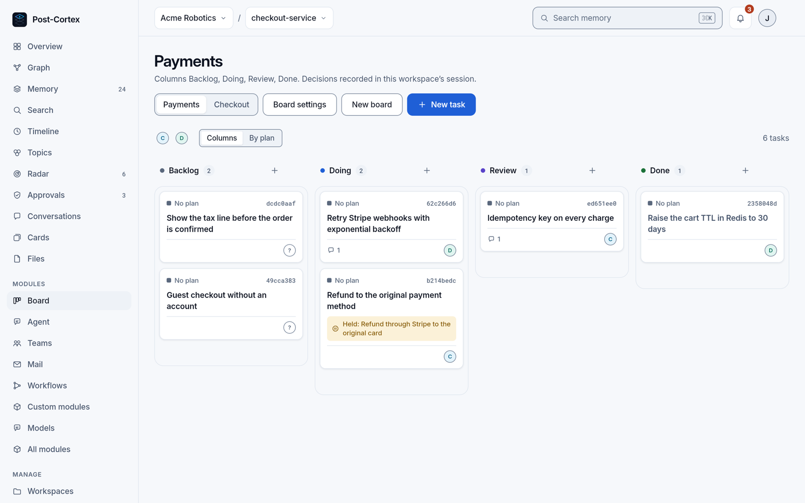
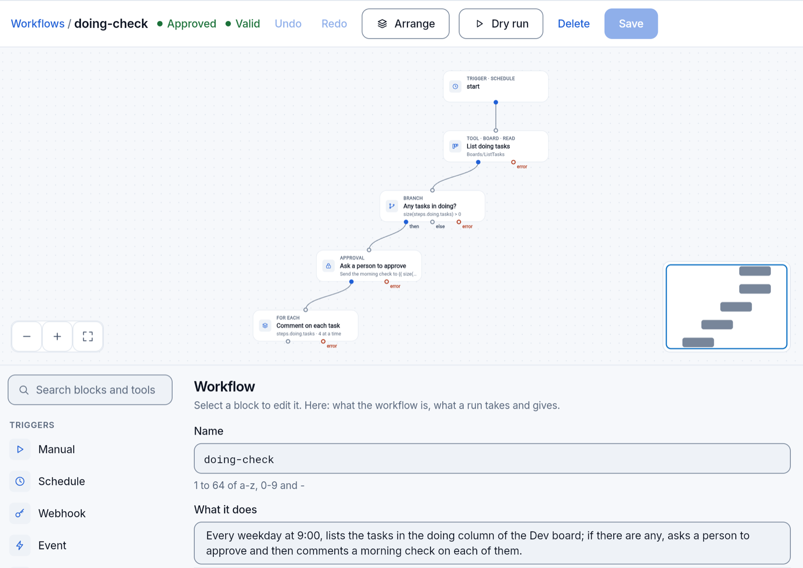

<p align="center">
  
</p>

<h1 align="center">pcx</h1>

<p align="center"><strong>The harness your AI agents work in, with a memory that lasts.</strong></p>

<p align="center">
  <a href="https://pcx.is">Website</a> ·
  <a href="https://docs.pcx.is">Documentation</a> ·
  <a href="https://docs.pcx.is/start/quickstart/">Quickstart</a> ·
  <a href="https://app.pcx.is">App</a> ·
  <a href="https://discord.gg/PGkDGd6a72">Discord</a>
</p>

> **Post-Cortex is now PCX.** Post-Cortex started as a memory for AI agents. Around it we
> built a harness that we use every day: one binary that hosts the memory and the other
> modules. With 0.6.0 we open that harness, with its modules and tools. Post-Cortex is still
> here, as the memory module, and still works on its own.

<picture>
  <source media="(prefers-color-scheme: dark)" srcset="docs/images/overview-dark.png">
  
</picture>

**post-cortex** is the memory. What your agent decides, fixes and learns becomes a typed
record, linked into a graph and searchable by meaning, so the next session starts from what
the last one knew. It works on its own.

**pcx** is the harness around it. One binary hosts the memory and the other modules, and
checks every call against what each module is allowed to do. Run it on your own machine, or
use the hosted service at [pcx.is](https://pcx.is).

## What it does

- **Memory**: typed records, a graph of what they talk about, search by meaning and by
  words, project and user cards, captured conversations.
  [Search](https://docs.pcx.is/why/search/) · [Graph](https://docs.pcx.is/why/graph/) · [Cards](https://docs.pcx.is/why/cards/)
- **Board and teams**: agents and people share tasks and decisions; a decision with a risk
  waits for a person. [Board](https://docs.pcx.is/why/board/)
- **Workflows**: graphs of steps over every module's tools, run by hand, on a schedule, on
  a webhook or on an event. [Workflows](https://docs.pcx.is/why/workflows/)
- **Modules**: scheduler, webhooks, HTTP, mail, Telegram, Discord, skills, your own model
  keys, files, shell and git, and modules you write in Rust, Python or TypeScript.
  [All modules](https://docs.pcx.is/modules/)
- **Your agent**: Claude Code through its plugin; Codex, Cursor, Gemini CLI, OpenCode,
  VS Code and others through `pcx setup`; anything else over MCP, gRPC or REST.
  [Connect your agent](https://docs.pcx.is/agents/claude-code/)

<picture>
  <source media="(prefers-color-scheme: dark)" srcset="docs/images/graph-dark.png">
  
</picture>

<picture>
  <source media="(prefers-color-scheme: dark)" srcset="docs/images/board-dark.png">
  
</picture>

<picture>
  <source media="(prefers-color-scheme: dark)" srcset="docs/images/workflow-editor-dark.png">
  
</picture>

## Quick start

**Hosted.** Create an account at [app.pcx.is](https://app.pcx.is) and follow the
[quickstart](https://docs.pcx.is/start/quickstart/): five minutes to an agent that remembers.

**On your own machine.**

```bash
brew install julymetodiev/tap/post-cortex    # or a binary from the releases page
pcx start                                    # the daemon, on 127.0.0.1:3737
pcx setup --self-hosted                      # point your agents at it
```

More in [Install and start](https://docs.pcx.is/daemon/install/).

## Build on it

Write a module, call the APIs or use the client SDKs:
[Writing a module](https://docs.pcx.is/build/writing-a-module/) ·
[APIs](https://docs.pcx.is/build/apis/). The specification of the code is
[`docs/ARCHITECTURE.md`](docs/ARCHITECTURE.md); what changed is in
[`CHANGELOG.md`](CHANGELOG.md).

## License

MIT. See [LICENSE](LICENSE).
